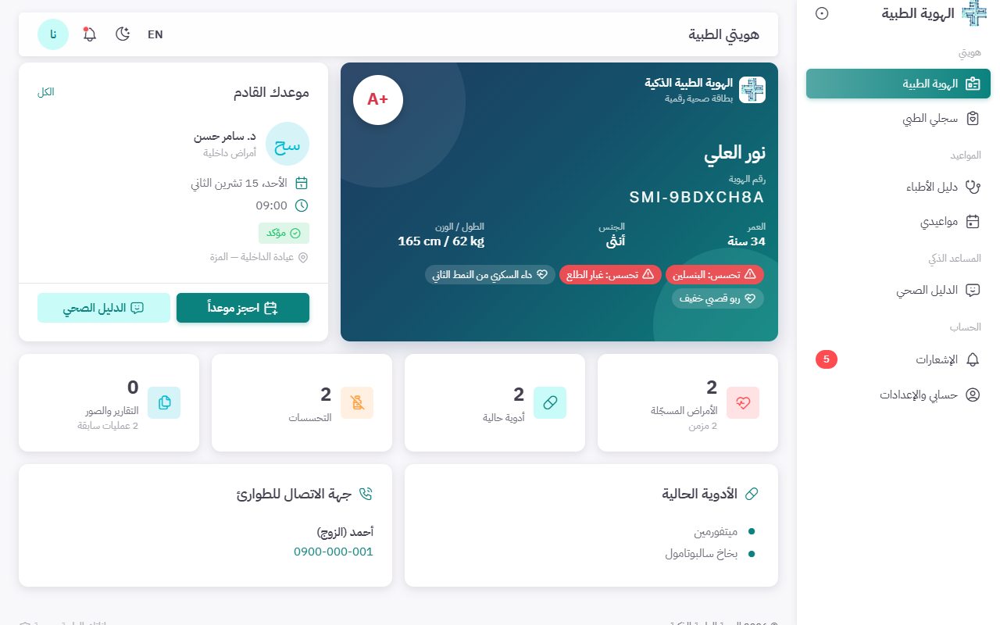
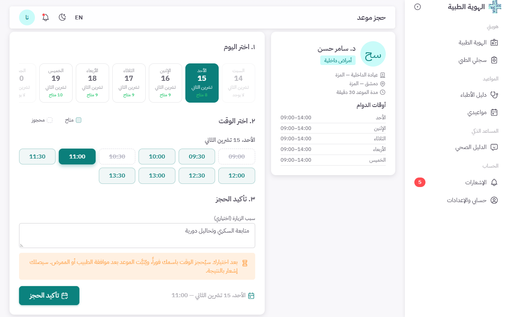
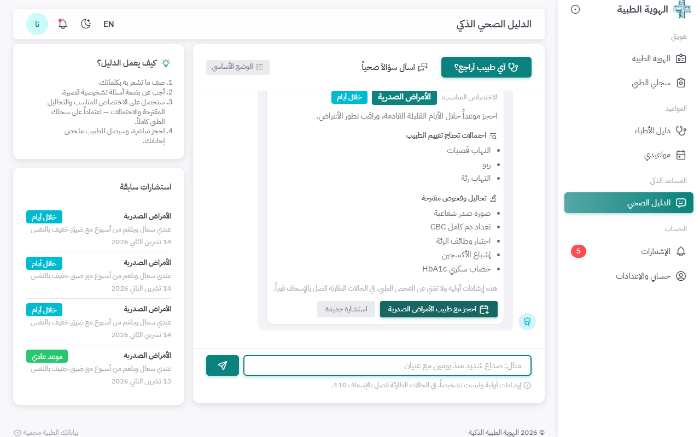
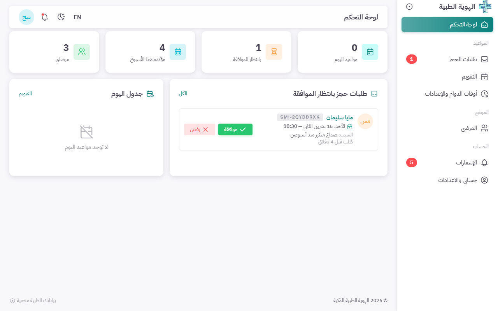
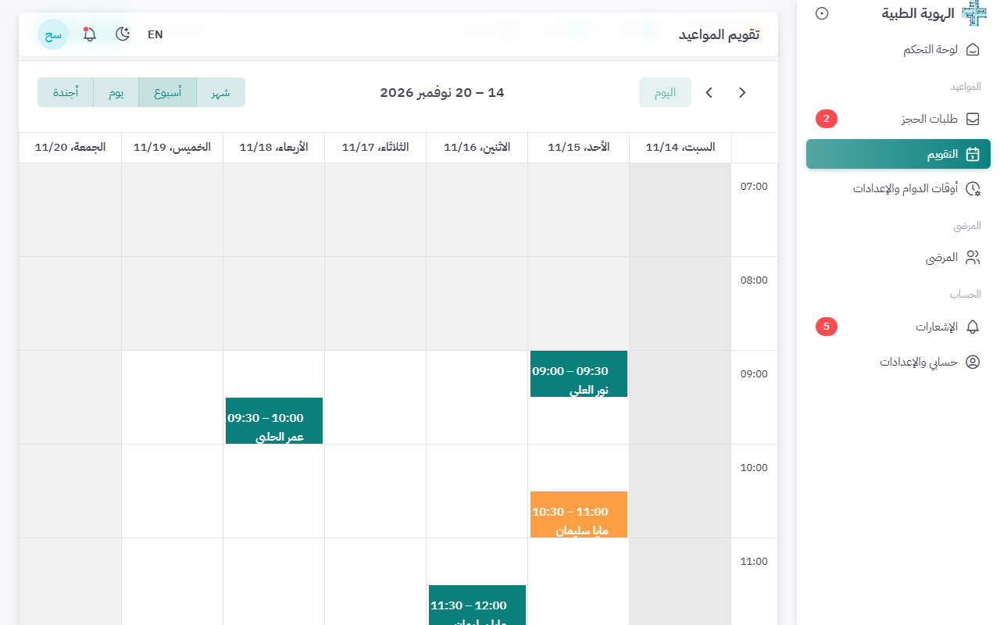
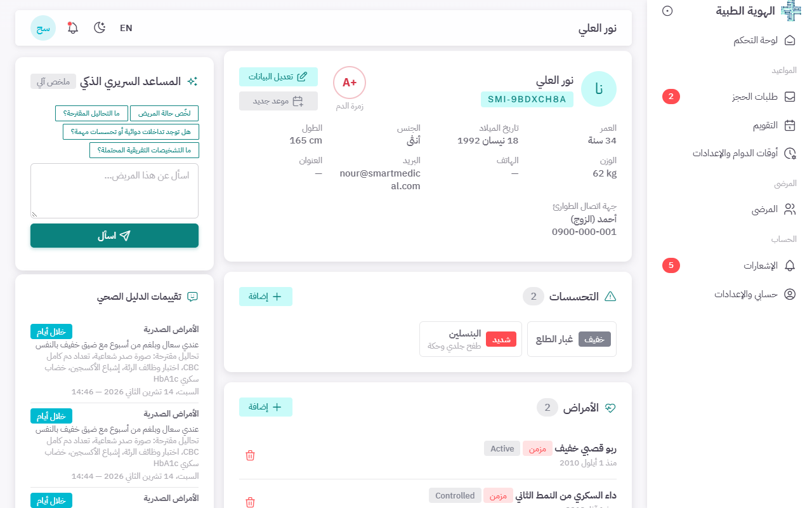
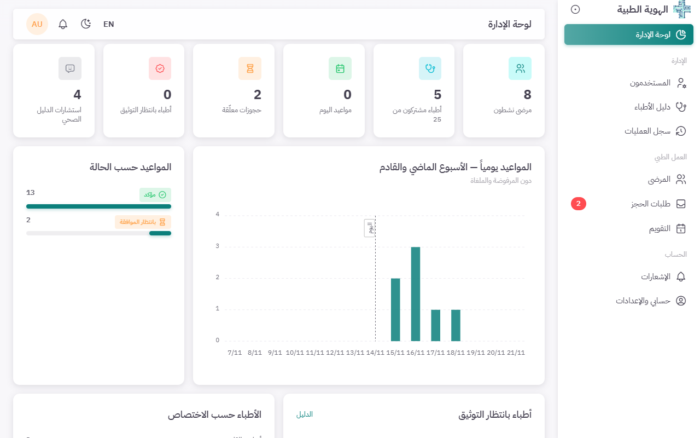
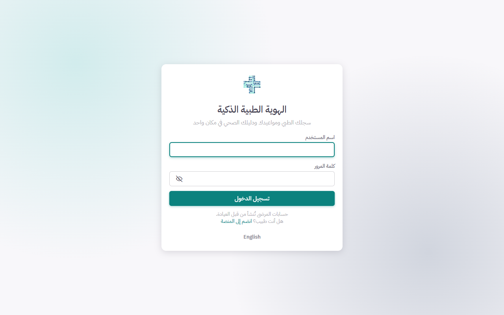
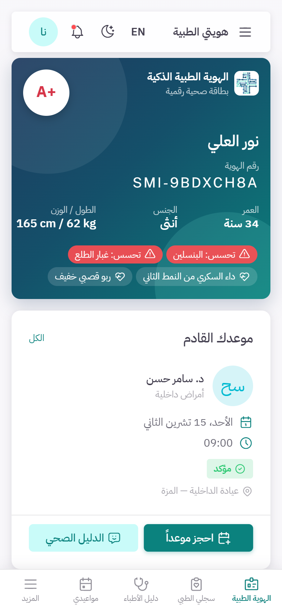

# Smart Medical ID — الهوية الطبية الذكية

A full-stack digital health platform: a medical ID for every patient, a national doctors directory,
online booking with doctor/nurse approval, real-time notifications, and an AI health guide that
recommends the right specialty. Installable as a PWA, Arabic (RTL) and English.

**Highlights**
- **Race-safe booking** — a conditional unique constraint in the database guarantees a slot can never be
  double-booked; verified with 186 concurrent bookings under load (0 overlaps).
- **Role-based access** (Admin / Doctor / Nurse / Patient) centralised in one module and covered by tests.
- **AI triage with a fallback** — a local LLM (Ollama) asks diagnostic questions and returns a structured
  result; a deterministic rule engine takes over when the model is unavailable, so the feature never breaks.
- **PWA** — service worker caching, offline page, Web Push notifications (VAPID), installable on phones.
- **Performance** — 150 concurrent users, 0 errors, 42 ms median, 230 ms p95 ([report](loadtest/REPORT.md)).
- **27 automated API tests** running in ~1.5 s.

### Screenshots

| Patient — medical ID | Online booking |
|---|---|
|  |  |
| **AI health guide** | **Doctor — booking requests** |
|  |  |
| **Doctor — calendar** | **Patient record (staff view)** |
|  |  |
| **Admin dashboard** | **Login** |
|  |  |

<p align="center"></p>

**Stack:** Python · Django 5.2 · Django REST Framework · SimpleJWT · SQLite (WAL) · WhiteNoise · Waitress ·
Bootstrap 5 / Vuexy · vanilla JavaScript · FullCalendar · Ollama (qwen3) · pywebpush · Locust.

### Run locally

```powershell
cd backend
python -m venv .venv; .venv\Scripts\pip install -r requirements.txt
.venv\Scripts\python manage.py migrate
.venv\Scripts\python manage.py seed_demo        # demo directory + demo accounts (docs/demo-accounts.md)
node ..\frontend\tools\build-theme.js "<path-to-your-Vuexy-template>"   # see frontend/assets/vendor/README.md
.venv\Scripts\python manage.py runserver
```
Open http://127.0.0.1:8000 — the UI and the API are served from the same origin.
Tests: `.venv\Scripts\python manage.py test core_app`. Optional AI: install [Ollama](https://ollama.com) and run `ollama pull qwen3`.

> The UI theme is the commercial Vuexy template, which cannot be redistributed; its files are generated
> locally from a licensed copy by `frontend/tools/build-theme.js`.

© 2026 Lana Mimi — all rights reserved. See [LICENSE](LICENSE).

---

## بالعربية

نظام صحي رقمي: هوية طبية لكل مريض، دليل أطباء البلد، حجز مواعيد إلكتروني بموافقة الطبيب/الممرض،
إشعارات فورية، ودليل صحي ذكي يرشّح الاختصاص المناسب. يعمل كتطبيق ويب قابل للتثبيت (PWA) بالعربية والإنكليزية.

## التشغيل

```powershell
.\run-dev.ps1
```
ثم افتح http://127.0.0.1:8000 — الواجهة والـ API على نفس العنوان.
ملفات قالب Vuexy تُبنى مرة واحدة من نسختك المرخّصة: `node frontend/tools/build-theme.js "<مسار القالب>"`.

بيانات وحسابات تجريبية: `python manage.py seed_demo` — القائمة وسيناريو التجربة في [docs/demo-accounts.md](docs/demo-accounts.md).

## البنية

```
SmartMedicalID/
├── backend/            Django 5.2 + DRF
│   ├── core/           الإعدادات والروابط
│   └── core_app/
│       ├── models.py       المريض، الطبيب، الدوام، المواعيد، الإشعارات، جلسات الدليل الصحي…
│       ├── access.py       قواعد الصلاحيات (في مكان واحد)
│       ├── scheduling.py   محرك الحجز (الأوقات المتاحة، الحجز الآمن، موافقة/رفض/إلغاء)
│       ├── notify.py       الإشعارات داخل التطبيق + Web Push
│       ├── ai.py           الدليل الصحي والمساعد السريري (Ollama + محرك قواعد احتياطي)
│       └── tests.py        27 اختباراً آلياً
├── frontend/           الواجهة مبنية على قالب Vuexy (RTL، فاتح/داكن)
│   ├── app/js          core.js (API + i18n) · shell.js (القائمة والإشعارات) · record.js · staff.js
│   ├── patient/        هويتي · سجلي · دليل الأطباء · الحجز · مواعيدي · الدليل الصحي
│   ├── staff/          لوحة الطبيب/الممرض · طلبات الحجز · التقويم · المرضى · ملف المريض · أوقات الدوام
│   ├── admin/          لوحة الإدارة · المستخدمون · دليل الأطباء والتوثيق · سجل العمليات
│   ├── sw.js · manifest.webmanifest · offline.html   (PWA)
│   └── tools/build-theme.js   يبني ملفات القالب المصغّرة بلون الهوية من نسخة Vuexy الأصلية
└── loadtest/           اختبار الضغط (Locust) + REPORT.md
```

القالب الأصلي الكامل محفوظ دون تعديل في `D:\medicalProject\Vuexy-Original-Template`.

## الصلاحيات (كما في النسخة الأصلية)

| | المشرف | الطبيب | الممرض | المريض |
|---|---|---|---|---|
| عرض ملفات المرضى | الكل | الكل | الكل | ملفه فقط |
| تعديل السجل الطبي | ✓ | ✓ | ✓ | الهاتف/البريد/العنوان فقط |
| إنشاء مريض | ✓ | ✓ | ✓ | ✗ (لا تسجيل ذاتي) |
| حذف دواء / حساسية / زيارة | الكل | دواء | ✗ | ✗ |
| حجز موعد | ✓ | ✓ | ✓ | لنفسه |
| موافقة / رفض الحجز | ✓ | ✓ | ✓ | ✗ |
| المستخدمون وتوثيق الأطباء | ✓ | ✗ | ✗ | ✗ |

الطبيب يمكنه التسجيل بنفسه، لكن حسابه **بلا أي صلاحية** حتى يوثّقه المشرف.

## الحجز الإلكتروني

1. الطبيب يحدّد أيام وساعات دوامه ومدة الموعد (أوقات الدوام والإعدادات).
2. المريض يختار طبيباً مشتركاً ← يوماً ← وقتاً متاحاً. الأوقات المحجوزة تظهر مشطوبة.
3. يُحجز الوقت فوراً باسم المريض (لا أحد غيره يستطيع أخذه) بحالة **بانتظار الموافقة**، ويصل إشعار للطبيب والممرضين.
4. الطبيب أو الممرض يوافق ← **مؤكد** + إشعار للمريض. أو يرفض مع سبب ← يتحرّر الوقت + إشعار.
5. خيار للطبيب: **تثبيت فوري** دون موافقة.
الأطباء غير المشتركين يظهرون في الدليل بمعلوماتهم ورقم الهاتف فقط.

## الإشعارات و PWA
- جرس الإشعارات يتحدّث كل 30 ثانية، وإشعارات النظام (Push) عند تفعيلها من "حسابي" — تصل حتى لو التطبيق مغلق.
- التطبيق قابل للتثبيت على الهاتف والكمبيوتر، ويعرض صفحة "لا يوجد اتصال" دون إنترنت. البيانات الطبية لا تُخزَّن في ذاكرة الجهاز.
- **مهم:** على أي عنوان غير localhost يلزم HTTPS حتى يعمل التثبيت والإشعارات.

## الاختبارات والأداء
```powershell
cd backend; .venv\Scripts\python.exe manage.py test core_app
```
نتائج اختبار الضغط في [loadtest/REPORT.md](loadtest/REPORT.md): 150 مستخدماً متزامناً، 0 أخطاء، وسيط 42ms.

## الإنتاج
انسخ `.env.example` واضبط المتغيرات، ثم `.\run-prod.ps1` خلف HTTPS. لأكثر من ~200 مستخدم متزامن يُنصح بـ PostgreSQL.
